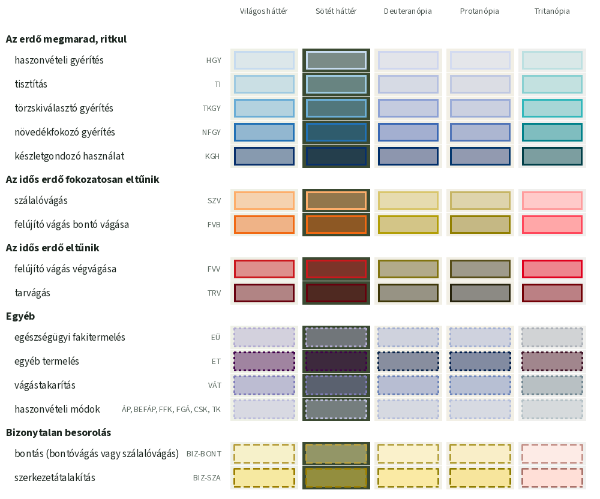

# Fahasználati módok – fogalomtár

A térképen szereplő fahasználati (fakitermelési) módok hivatalos neve, kódja és rövid, közérthető leírása, jogszabályi vagy hatósági forrással. A leírások saját megfogalmazások; jogszabályból és hatósági dokumentumból csak rövid idézet szerepel. Mértékadó mindig a hatályos jogszabályszöveg.

Kapcsolódó issue-k: #8 (nevezéktan), #9 (ez a fogalomtár), #10 (forrásonkénti leképezés), #11 (csoportosítás, színek), #12 (alkalmazás a térképen).

## Források

| Rövidítés | Forrás | Ellenőrzött állapot |
|---|---|---|
| Evt. | [2009. évi XXXVII. törvény az erdőről, az erdő védelméről és az erdőgazdálkodásról](https://njt.jog.gov.hu/jogszabaly/2009-37-00-00) | njt.hu, hatályos állapot: 2026. 10. 01. |
| Vhr. | [61/2017. (XII. 21.) FM rendelet az Evt. végrehajtásáról](https://njt.jog.gov.hu/jogszabaly/2017-61-20-11) | njt.hu, hatályos állapot: 2024. 07. 01. |
| NÉBIH 2019 | [Kitöltési útmutató végrehajtott fakitermelési munkák bejelentéséhez (hatályos: 2019. december 19.)](https://portal.nebih.gov.hu/documents/10182/1213871/Kit%C3%B6lt%C3%A9si+%C3%BAtmutat%C3%B3+v%C3%A9grehajtott+fakitermel%C3%A9si+munk%C3%A1k+bejelent%C3%A9s%C3%A9hez_2019_11_V2.pdf) | a fakitermelési kódlista a dokumentum 2–3. oldalán (nyomtatott oldalszám nincs) |
| NÉBIH 2018 | [Kitöltési útmutató végrehajtott fakitermelési munkák bejelentéséhez (hatályos: 2018. július 1.)](https://portal.nebih.gov.hu/documents/10182/1059308/Kit%c3%b6lt%c3%a9si+%c3%batmutat%c3%b3+v%c3%a9grehajtott+fakitermel%c3%a9si+munk%c3%a1k+bejelent%c3%a9s%c3%a9hez_2018_07.1.pdf) | a kódlista megegyezik a 2019-essel |
| EL 2019 | Csépányi Péter: A különböző üzemmódok és az örökerdő-gazdálkodás. [Erdészeti Lapok CLIV. évf. 5. szám (2019. május), 138–142. o.](https://erdeszetilapok.oszk.hu/01846/pdf/EPA01192_erdeszeti_lapok_2019_05_138-142.pdf) | szakirodalom, az üzemmódok magyarázatához |

Átnézve, de ehhez a témához nem ad kódlistát vagy definíciót:

- [433/2017. (XII. 21.) Korm. rendelet](https://njt.jog.gov.hu/jogszabaly/2017-433-20-22) (erdészeti hatósági eljárások, bejelentések): nincs benne fakitermelési kódlista.
- [NÉBIH Erdőrészletleíró-lap kódjegyzéke](https://portal.nebih.gov.hu/documents/10182/1047668/Le%C3%ADr%C3%B3+lap_k%C3%B3djegyz%C3%A9k_v01.pdf/db5854b5-03bc-87db-c866-69355125afab): nincs benne fakitermelési vagy üzemmód-kódtábla.
- [45/2015. (VII. 28.) FM rendelet](https://njt.jog.gov.hu/jogszabaly/2015-45-20-11) (a 2015. évi körzeti erdőtervezés alapelvei): még a 2017 előtti üzemmódneveket (szálaló, átalakító) használja, ezért csak a régebbi erdőtervek értelmezéséhez hasznos.

2019-nél frissebb NÉBIH-útmutatót, illetve hivatalos, nyilvános fogalomtárat (NÉBIH, Agrárminisztérium, Országos Erdészeti Egyesület) nem találtam.

## A fakitermelési módok jogi alapja

A fakitermelés módjait az **Evt. 71. § (1)** sorolja fel (nem az 5. § fogalommeghatározásai): a) tisztítás, b) gyérítés, c) tarvágás, d) fokozatos felújítóvágás, e) szálalóvágás, f) készletgondozó használat, g) egészségügyi fakitermelés, h) egyéb termelés. A gyérítés alfajait (törzskiválasztó, növedékfokozó, haszonvételi) és a módok részletszabályait a **Vhr. 46–47/A. §** adja. A NÉBIH bejelentési kódjai ezekre épülnek.

Az Evt. 5. §-ából ide tartozik:

- **12. pont – faállomány záródása:** a fák koronavetületének és a faállomány területének százalékos aránya.
- **13. pont – folyamatos erdőborítás:** „olyan állapot, amikor az erdő többkorú faállománya folyamatosan borítja az erdő talaját”.
- **25. pont – véghasználat:** „vágásos vagy átmeneti üzemmódban kezelt erdőben végrehajtott fakitermelés”, amely után erdőfelújítási kötelezettség keletkezik.

Nevelővágás néven a törvény nem határoz meg fogalmat. Az Evt. 53. § „erdőnevelési célú fakitermelésekről” beszél, a Vhr. 24. § (3) használja a „nevelővágás” szót. A szakmai szóhasználatban a tisztítás és a gyérítések tartoznak ide.

## Kódok

Az „Erdőfelújítási kötelezettség” oszlopban a *záródási kivétel* azt jelenti: kötelezettség nem keletkezik, kivéve ha a beavatkozás miatt a faállomány záródása összefüggően 2 hektárt meghaladó területen 60% alá csökken (felnyíló erdőben 30%, felnyitott erdőben 50% alá) – Evt. 51. § (2) c), NÉBIH 2019.

| Kód | Hivatalos név | Leírás | Marad erdőborítás? | Erdőfelújítási kötelezettség | Forrás |
|---|---|---|---|---|---|
| TI | Tisztítás | Fiatal erdőben a nem kívánt, rossz alakú vagy elnyomó egyedek kivétele, hogy a többi jól fejlődjön. | igen | záródási kivétel | Evt. 71. § (1) a); Vhr. 46. § (2); NÉBIH 2019 |
| TKGY | Törzskiválasztó gyérítés | Fiatal–középkorú állományban a jövőbeli célfák kiválasztása és a velük versengő fák kivágása. | igen | záródási kivétel | Evt. 71. § (1) b); Vhr. 46. § (3); NÉBIH 2019 |
| NFGY | Növedékfokozó gyérítés | Idősebb állomány ritkítása, hogy a visszamaradó fák jobban növekedjenek. | igen | záródási kivétel | Evt. 71. § (1) b); Vhr. 46. § (4); NÉBIH 2019 |
| HGY | Haszonvételi gyérítés | Kis erélyű gyérítés: az átlagos záródás legfeljebb 5%-kal csökkenhet. 2017. december 29. előtt „készletgondozó használat” volt a neve. | igen | „felújítási kötelezettséget nem keletkeztethet” | Vhr. 46. § (5); NÉBIH 2018, 2019 |
| KGH | Készletgondozó használat | Folyamatos erdőborítás mellett végzett fakitermelés: egyes fák vagy kisebb facsoportok kivétele a többkorú, vegyes szerkezetű erdő fenntartásával. Örökerdő üzemmódban csak ez a mód tervezhető. 2017. december 29. előtt „szálalás” volt a neve. | igen; örökerdőben nem maradhat 0,25 ha-nál nagyobb, felújítandó üres vágásterület | záródási kivétel | Evt. 71. § (1) f); Vhr. 24/A. § (1), 46. § (7), 47/A. § (1) c); NÉBIH 2019 |
| SZV | Szálalóvágás | Véghasználat: az idős állományt 30 évnél hosszabb idő alatt, több beavatkozással termelik ki, miközben alatta újulat nő fel. | nem minden esetben: ha az idős állomány záródása az erdőrészleten vagy annak 1 ha-t meghaladó összefüggő részén 30% alá csökken, az végvágásnak minősül | bontóvágás után van, de nem határidős; végvágás után határidős | Evt. 71. § (1) e); Vhr. 36. § (3), 46. § (6); NÉBIH 2019 |
| FVB | Felújító vágás bontó vágása | Véghasználat, a fokozatos felújítóvágás része: az idős állomány megritkítása, hogy alatta az újulat megtelepedjen és fényhez jusson. A teljes felújítás legfeljebb 30 év. | részben; a 30%-os szabály itt is érvényes | van, nem határidős; mértéke a kitermelés miatti záródáshiány | Evt. 71. § (1) d); Vhr. 36. § (3), 47. § (1); NÉBIH 2019 |
| FVV | Felújító vágás végvágása | A fokozatos felújítóvágás utolsó lépése: az újulat fölül a megmaradt idős fák kitermelése. Utána a területen csak fiatalos marad. | nem | határidős | Evt. 71. § (1) d); Vhr. 36. § (3); NÉBIH 2019 |
| TRV | Tarvágás | Véghasználat: az állomány kitermelése egyetlen beavatkozással. A törvény korlátozza az egybefüggő, felújítási kötelezettség alatt álló terület nagyságát (5–20 ha, a domborzattól és az erdő természetességi állapotától függően). | nem | határidős | Evt. 71. § (1) c), 74. § (1); NÉBIH 2019 |
| EÜ | Egészségügyi fakitermelés | Elhalt, súlyosan sérült, illetve kártevők elszaporodását okozó fák kivétele. Bejelentett erdőkár után a faállomány legfeljebb 10%-áig. | jellemzően igen | a kódnál nincs külön kimondva | Evt. 71. § (1) g); NÉBIH 2019 |
| ET | Egyéb termelés | Minden más fakitermelés, például fátlan terület fenntartása vagy balesetveszély megelőzése. | változó | „erdőfelújítási kötelezettség nem keletkezik” | Evt. 71. § (1) h); Vhr. 21. § (8) c); NÉBIH 2019 |
| VÁT | Erdőfelújítás érdekében végzett vágástakarítás | Egy korábban bejelentett fakitermelés után ottmaradt faanyag összegyűjtése. A jelenlegi adatokban nem szerepel. | – | – | Vhr. 43. § (8); NÉBIH 2019 |

A NÉBIH a fakitermelési módok mellett *haszonvételi módokat* is használ (ÁP, BEFÁP, FFK, FGÁ, CSK, TK: ápolás, felkészítés, gallygyűjtés, cserje- és tuskótermelés). Ezek a jelenlegi adatokban nem szerepelnek, de a rendszer ismeri őket (NÉBIH 2019, 4. o.).

## Üzemmódok

Evt. 29. § (2):

- **vágásos:** közel egykorú faállomány fenntartása és nevelése, ciklikus véghasználattal és erdőfelújítással;
- **örökerdő:** „erdőfelújítási kötelezettséget keletkeztető véghasználati fakitermelés nem történik”; a faállomány szerkezete változatos, az erdőborítás folyamatos;
- **átmeneti:** a fő cél „a vágásos üzemmódról az örökerdő üzemmódra való áttérés”; egy felújítási ütemben legfeljebb 1,5 ha-os egybefüggő végvágott terület alakítható ki (Vhr. 1. § 21–22. pont);
- **faanyagtermelést nem szolgáló:** „faállomány-gazdálkodásra nem kerül sor”.

Közérthető összefoglaló: EL 2019, 138–139. o.

## Régi és új elnevezések

A NÉBIH előírása szerint a bejelentésben a jogszabályban szereplő módokat kell használni, akkor is, ha egy korábbi erdőtervben még a régi elnevezés szerepel (NÉBIH 2018).

| Régi (2017. december 29. előtt) | Ma | Forrás |
|---|---|---|
| szálalás | KGH – készletgondozó használat | NÉBIH 2018, 2019 |
| KH – készletgondozó használat | HGY – haszonvételi gyérítés (a KH rövidítést már nem használják) | NÉBIH 2018, 2019 |
| szálaló üzemmód | örökerdő üzemmód | EL 2019, 139. o. |
| átalakító üzemmód | átmeneti üzemmód | a két definíció tartalmi megfelelése (45/2015. FM rendelet 3. §, ill. Evt. 29. § (2) c)); kifejezett jogszabályi kimondást nem találtam |

## Nem fakitermelési mód: erdőszerkezet-átalakítás

A BP Erdő „szerkezetátalakítás” megnevezése nem szerepel a NÉBIH fakitermelési kódlistájában. Az **Evt. 55. §** szerint az erdőszerkezet-átalakítás egy tevékenység, amely a meglévő erdő természetességi állapotán változtat; „nem tartozik a rendes erdőgazdálkodás körébe” (55. § (2)). Egy erdészeti támogatási rendelet szerint egyik formája a [tarvágást követő, fafajcserés szerkezetátalakítás](https://njt.jog.gov.hu/jogszabaly/2009-139-20-82) (139/2009. FVM rendelet, fogalommeghatározások 14. pont és 3. §), és a 45/2015. FM rendelet fakitermelés-tervezési alapelvei is a tarvágás kivételes eseteként említi a fafajcserével járó erdőszerkezet-átalakítást. Ugyanakkor a Vérteserdő a saját magyarázata szerint az idegenhonos állományok fokozatos, a véghasználat körébe nem tartozó átalakítását egyéb termelésként (ET) közli. A mögötte álló fakitermelés hatósági kódja így lehet TRV, FVB/FVV vagy ET is; a nyilvános adatokból nem állapítható meg (l. a leképezésnél).

Ezért a térkép ezt a módot a *bizonytalan besorolású* módok között, saját, nem hatósági `BIZ-SZA` kulccsal mutatja (l. alább).

## Bizonytalan besorolás

Ha egy forrás elnevezése nem feleltethető meg egyértelműen egy hatósági kódnak, a térkép nem találgat, hanem a „Bizonytalan besorolás” csoportban, saját, `BIZ-` kezdetű kulccsal mutatja. A leírás megadja a szóba jövő hatósági kódokat. Ha a forrás később megadja a kódot (vagy írásos forrás kerül elő), a leképezés átírandó a hatósági kódra, és a `BIZ-` mód kivezethető, ha már nem használja egyik forrás sem.

| Kulcs | Név a térképen | Szóba jövő hatósági kód | Forrás |
|---|---|---|---|
| `BIZ-BONT` | bontás (bontóvágás vagy szálalóvágás) | FVB (valószínű), SZV | BP Erdő; Vérteserdő `BO` (felkészülésként) |
| `BIZ-SZA` | szerkezetátalakítás | TRV, FVB/FVV, ET | BP Erdő; Vérteserdő `SZA` (felkészülésként) |

A források saját magyarázatainak átnézése, és a bizonytalan esetek tisztázása: #20.

## A források saját magyarázatai

Ahol egy erdőgazdaság maga is elmagyarázza, mit ért egy-egy módon, azt itt foglalom össze saját szavakkal (#20; átnézve: 2026. 11. 24.). Ezek az erdőgazdaságok saját értelmezései, nem jogforrások. Arra jók, hogy ellenőrizzük a leképezést.

**Egererdő** – a Google Saját térképen minden pontnak van „A beavatkozás célja” mezője. Ez nem részletenként egyedi, hanem módonként egy sablonszöveg (a növedékfokozó gyérítésnél kettő, egy elírásban térnek el).
- *Fokozatos felújítóvágás – bontóvágás:* az idős erdő 10–30 év alatti, fokozatos megújítása; az erdőborítás közben részben megmarad, az idős fák árnyékában nő fel az újulat. Ez megfelel az FVB-nek (a fokozatos felújítóvágás legfeljebb 30 év), a leképezés megerősítve.
- *Szálalóvágás:* legalább 30 év alatt, egyszerre csak kisebb részeken; a cél a többkorú erdő. Megfelel az SZV-nek.
- *Készletgondozó használat:* egy fa vagy kis facsoport (lék) kitermelése folyamatos erdőborítás mellett. Ez a 2017 utáni jelentés, l. a leképezés 4. pontját.
- *Tarvágás:* főként kiszáradt vagy súlyosan károsodott fenyőállományoknál, őshonosabb fafajokra cserélve, illetve sarjról felújuló állományoknál.
- *Egyéb termelés:* főként természetvédelmi célú beavatkozás, de lehet örökségvédelmi, közjóléti, tájvédelmi vagy biztonsági célú is.
- *Tisztítás, törzskiválasztó és növedékfokozó gyérítés, egészségügyi fakitermelés:* a hivatalos jelentéssel egyezik.

**Vérteserdő** – kétféle magyarázat van: a Google Saját térkép „Állománynevelés leírása” mezője (módonként egy sablonszöveg) és a honlapon módonként egy aloldal (az [Aktuális tevékenységeink](https://verteserdo.hu/aktualis-tevekenysegeink/) oldalról).
- A honlap külön mutatja be a bontóvágást, a végvágást és a szálalóvágást. A [bontóvágás](https://verteserdo.hu/bontovagas) aloldala nem mondja meg, hogy a fokozatos felújítóvágás vagy a szálalóvágás része, ezért a `BO` kód továbbra is bizonytalan besorolású marad.
- A [szálalóvágás](https://verteserdo.hu/szalalovagas): 30 évnél hosszabb, ismételt beavatkozások, változatos korszerkezettel. Megfelel az SZV-nek.
- A [tarvágás](https://verteserdo.hu/tarvagas): véghasználat, mesterséges erdősítéssel; például Natura 2000-es területen lévő akácosokban, nemesnyárasokban, és sarjeredetű őshonos erdőkben, ha az idős állomány már nem tud magról felújulni.
- *Egyéb termelés* (térkép): a balesetveszélyes fák kitermelése mellett ide sorolják az idegenhonos állományok szálalóvágáshoz hasonló, véghasználatnak nem minősülő átalakítását is. Ez a „szerkezetátalakítás” egyik lehetséges hatósági kódja (l. fent).

**Mecsekerdő** – a [honlapon](https://mecsekerdo.hu/fenntarthato-gazdalkodas/erdokezelesunk/) látható magyarázatok a beágyazott Power BI-jelentésből jönnek („Mit jelent a használati mód?” táblázat: kód és név, életszakasz, magyarázat). A honlap statikus szövege és a [fakitermelési technológiai utasítás](https://mecsekerdo.hu/kozerdeku-adatok/fakitermelesi-altalanos-technologiai-es-muveleti-utasitas/) nem határoz meg módokat. A táblázat a NÉBIH-kódokat és -neveket használja, a magyarázatok a hivatalos jelentéssel egyeznek; a KGH-nál zárójelben „(szálalás)”. A táblázat csak az éppen ütemezett módokat mutatja, ezért a **HF** és a **FELK** jelentése innen sem derül ki.

**BP Erdő** – a [listán](https://www.bp-erdo.hu/hu/2026-evben-meg-hatralevo-tervezett-fakitermelesek) nincs magyarázat, és más, a módokat magyarázó oldalt sem találtam. A „bontás” és a „szerkezetátalakítás” hatósági kódja csak tőlük (vagy az illetékes nemzeti park igazgatóságtól) kérdezhető meg írásban.

**Importáláskor:** a `mymaps-kml-export.js` a módonkénti magyarázó szövegek ujjlenyomatát is kiírja, és a `data/verteserdo.js`, `data/egererdo.js` `modleirasok` mezőjében tárolt értékkel összevetve jelzi, ha egy magyarázat megváltozott. A Mecsekerdőnél a Power BI „Mit jelent a használati mód?” táblázatát kell kézzel átnézni. A szövegeket nem tárolom a repóban, csak az ujjlenyomatukat.

## Leképezés: a források elnevezései → hivatalos kód

A térkép (`MODES` az `index.html`-ben) és az adatfájlok (`data/*.js`, a sor 2. eleme) a hivatalos NÉBIH-kódot használják; a megjelenített név külön mező. Kivétel a bizonytalan besorolás (l. alább). A forrásonkénti fordítás az importszkriptekben van: `tools/nebih-export.js` (`CODES`, a BP Erdő listájához), `tools/mymaps-kml-export.js` (presetenként `codes`), `tools/powerbi-export.js` (`codes`). A szkriptek a hivatalos kódot és a hivatalos nevet (kis- és nagybetűtől függetlenül) maguktól felismerik, ezért a táblában csak az ettől eltérő elnevezéseket kell felsorolni; minden mást ismeretlenként jeleznek, és a CI ellenőrzése is elbukik rajta. Ha a forrás elnevezése eltér a hivatalos kódtól és névtől, a szkriptek a sor `extra` mezőjébe „Fahasználat a forrás szerint” címkével beírják, így a felugró ablakban is látszik, mit közölt a forrás.

A rendszerben minden NÉBIH fakitermelési és haszonvételi kód szerepel (a kódlista fent), akkor is, ha a jelenlegi adatokban nem fordul elő. A térkép jelmagyarázatában csak az adatokban ténylegesen előforduló módok jelennek meg.

Az „Előfordulás” oszlop a 2026. 11. 23-i importok részletszáma; a „–” azt jelenti, hogy a forrás most nem használja, csak felkészültünk rá.

| Forrás | A forrás elnevezése / kódja | Hivatalos kód | Előfordulás | Megjegyzés |
|---|---|---|---|---|
| BP Erdő | tisztítás | TI | 1 | a hivatalos név |
| BP Erdő | törzskiválasztó gyérítés | TKGY | 1 | a hivatalos név |
| BP Erdő | növekedésfokozó gyérítés | NFGY | 23 | szinonima, l. 1. |
| BP Erdő | egyéb termelés | ET | 11 | a hivatalos név |
| BP Erdő | bontás | `BIZ-BONT` (bizonytalan) | 2 | valószínűleg FVB, l. 2. |
| BP Erdő | szerkezetátalakítás | `BIZ-SZA` (bizonytalan) | 2 | a fakitermelés módja nem ismert, l. 3. |
| Vérteserdő | TI, TKGY, NFGY, EÜ, ET, TRV | ugyanaz | 9, 38, 32, 11, 6, 2 | NÉBIH-kódok; a weboldaluk magyarázó szövegei a hivatalos neveket használják („Növedékfokozó gyérítés”, „Egészségügyi fakitermelés”) |
| Vérteserdő | BO | `BIZ-BONT` (bizonytalan) | – | feltételezett; az eddigi importokban nem fordult elő. A weboldaluk a „Bontóvágás”-t a „Szálalóvágás”-tól külön sorolja fel, ezért valószínűleg FVB, l. 2. |
| Vérteserdő | SZA | `BIZ-SZA` (bizonytalan) | – | feltételezett; az eddigi importokban nem fordult elő, l. 3. |
| Vérteserdő | más NÉBIH-kód (pl. FVB, FVV, SZV) | ugyanaz | – | a weboldaluk a végvágást és a szálalóvágást is felsorolja |
| Mecsekerdő | TI, TKGY, NFGY, EÜ, ET, KGH, SZV, FVB, FVV, TRV | ugyanaz | 53, 47, 30, 2, 8, 13, 6, 28, 13, 6 | a Power BI-modell `D_Hmod` táblája a NÉBIH-kódokat és -neveket használja; KGH: l. 4. |
| Mecsekerdő | HGY, VÁT, ÁP, BEFÁP, FFK, FGÁ, CSK, TK | ugyanaz | – | a modellben szerepelnek, az ütemezésben most nem |
| Mecsekerdő | HF, FELK | – | – | a modellben szerepelnek, de nem NÉBIH-kódok, a jelentésük nem ismert; ha megjelennek, a szkript jelzi, l. 5. |
| Egererdő | Tisztítás, Törzskiválasztó gyérítés, Növedékfokozó gyérítés, Egészségügyi fakitermelés, Egyéb termelés, Készletgondozó használat, Szálalóvágás, Tarvágás | TI, TKGY, NFGY, EÜ, ET, KGH, SZV, TRV | 6, 27, 25, 3, 1, 1, 6, 9 | a hivatalos nevek; KGH: l. 4. |
| Egererdő | Fokozatos felújítóvágás – bontóvágás | FVB | 5 | egyértelmű; a saját magyarázatuk (10–30 év, fokozatos megújítás) is ezt erősíti |
| Egererdő | Fokozatos felújítóvágás – végvágás | FVV | – | feltételezett, a bontóvágás elnevezésének mintájára |

Összesen 427 részlet; az átalakítás előtt és után forrásonként azonos a részletszám és a hektárösszeg (BP Erdő 40 / 241,22 ha, Vérteserdő 98 / 849,56 ha, Mecsekerdő 206 / 1254,53 ha, Egererdő 83 / 834,03 ha).

### Indoklás

1. **„növekedésfokozó” = NFGY.** A Vhr. 46. § (4) és a NÉBIH kódlistája csak a *növedékfokozó gyérítés* nevet ismeri, „növekedésfokozó” gyérítés nincs a jogszabályokban. A BP Erdő listájában más NFGY-jellegű mód nem szerepel, a négy forrás közül csak ők használják ezt a szót. Szinonimaként kezeljük; a térkép a hivatalos nevet mutatja.
2. **„bontás” (BP Erdő), `BO` (Vérteserdő) → `BIZ-BONT`, valószínűleg FVB.** „Bontó vágás” néven a NÉBIH kódlistája csak a fokozatos felújítóvágás bontóvágását (FVB) jelöli; a szálalóvágásnak a bejelentésben nincs külön bontó kódja, ott minden lépés SZV. A két BP Erdő-részlet (Lábatlan 19 B, Tardos 8 D) a NÉBIH Erdőtérkép szerint vágásos üzemmódú (`UZEMMOD = VÁG`, lekérdezve: 2026. 11. 24.). Ez nem zárja ki teljesen a szálalóvágást (a Mecsekerdő vágásos üzemmódú részletekben is tervez SZV-t), ezért a térkép bizonytalan besorolásként mutatja. Ha a forrás megadja a hatósági kódot, a sor átírandó.
3. **„szerkezetátalakítás” → `BIZ-SZA`.** A két részlet (Neszmély 22 C és 22 G) a NÉBIH Erdőtérkép szerint erdeifenyves, kultúrerdő, vágásos üzemmódban (lekérdezve: 2026. 11. 24.). Ez összhangban van egy idegenhonos állomány lecserélésével, de a fakitermelés módját (TRV, FVB/FVV vagy ET, l. fent) a nyilvános adatok nem mutatják: a NÉBIH Erdőtérkép nyilvános rétegében tervezett fakitermelés nincs. A Vérteserdő `SZA` kódja egyik importban sem fordult elő (a 2026. 11. 23-i és 24-i KML-ben csak NFGY, TKGY, TI, EÜ, ET és TRV van); a szkriptben csak felkészülésként szerepel.
4. **KGH a mai jelentésében.** Mindkét forrás 2026-os adatot közöl, és a 2017. december 29. óta hatályos jelentést használja (a korábbi „szálalás”): a Mecsekerdő mind a 13 KGH-részlete „Örökerdő (szálaló)” üzemmódú, és a nevét is „KGH – Készletgondozó használat (szálalás)” alakban adja; az Egererdő egyetlen KGH-részlete (Cserépváralja 11 A) a NÉBIH szerint `SZÁL` üzemmódú (lekérdezve: 2026. 11. 24.). A régi értelemben vett készletgondozó használat (ma HGY) egyik forrásban sem szerepel. A „KH” és a „szálalás” egyik forrásban sem fordul elő.
5. **HF, FELK (Mecsekerdő).** Nem szerepelnek a NÉBIH 2018-as és 2019-es kódlistájában. A jelentésüket a Mecsekerdő modelljéből kell kiolvasni, mielőtt hivatalos kódhoz rendelnénk őket.

## Csoportosítás és színek

Döntések (#11), a térképen így jelennek meg a módok (`GROUPS` és `MODES` az `index.html`-ben).

**Összevonás.** A valódi szinonimák (azonos kód, eltérő név, pl. „növekedésfokozó” és „növedékfokozó gyérítés”) már a leképezésben egy kódra kerülnek (l. fent). A térképen kódonként egy jelmagyarázat-sor van.

**Csoportosítás: a térkép céljához igazodik, nem a jogszabályi kategóriákhoz.** A csoport azt mutatja, mennyire erős a beavatkozás, és mi marad utána a területen. Ezért eltér a jogi felosztástól: a szálalóvágás és a bontóvágás jogilag véghasználat, mint a végvágás és a tarvágás, de külön csoportba kerül, mert utána egy ideig még idős erdő áll. A készletgondozó használat pedig nem nevelővágás, mégis az „erdő megmarad” csoportba tartozik, mert folyamatos erdőborítás mellett történik.

| Csoport | Módok (gyengébbtől az erősebbig) | Mi marad a területen |
|---|---|---|
| Az erdő megmarad, ritkul | HGY, TI, TKGY, NFGY, KGH | erdő, kevesebb fával |
| Az idős erdő fokozatosan eltűnik | SZV, FVB | egy ideig idős fák, alattuk fiatal erdő |
| Az idős erdő eltűnik | FVV, TRV | fiatalos vagy beerdősítendő vágásterület |
| Egyéb | EÜ, ET, VÁT, haszonvételi módok (ÁP, BEFÁP, FFK, FGÁ, CSK, TK) | esetenként változó, ezért nincs erősség szerinti sorrend |
| Bizonytalan besorolás | BIZ-BONT, BIZ-SZA, és minden ismeretlen kód | a forrásból nem állapítható meg |

A csoporton belüli sorrend a térkép saját, közelítő sorrendje, nem jogszabályi rangsor. Az első csoportban nagyjából a kivett fák mérete szerint halad (fiatal → idős állomány), a haszonvételi gyérítés a legkisebb erélyű (legfeljebb 5% záródáscsökkenés). A második csoportban a szálalóvágás az elnyújtottabb (30 évnél hosszabb), a bontóvágás legfeljebb 30 év. A harmadikban a végvágás az utolsó lépés, a tarvágás egyszerre termeli ki az egész állományt.

**Színek.** Csoportonként egy árnyalatcsalád, a csoporton belül világos → sötét = gyengébb → erősebb:

- *az erdő megmarad:* kék;
- *az idős erdő eltűnik* (fokozatosan vagy egyszerre): egyetlen narancs → sötétvörös skála, a fokozatos csoport a világosabb fele;
- *egyéb:* lila, pontozott körvonallal;
- *bizonytalan besorolás:* sárga, szaggatott, sötétebb okker körvonallal; az ismeretlen kód is ide kerül, szürkén.

Zöld nincs a palettán, mert az erdő a háttértérképen és a műholdképen is zöld. A kitöltés 45%-os, a körvonal teljes színű; a bizonytalan csoport körvonala a kitöltésnél sötétebb okker, hogy a sárga vonal távolról ne világítson ki a többi közül. A színeket CAM02-UCS színtérben, színtévesztés-szimulációval ellenőriztem, világos és sötét (műholdas) háttéren. A fő különbség (kék kontra narancs–vörös) mindhárom színtévesztés-típusnál megmarad, a csoporton belüli módokat a világosság különbözteti meg. A lila és a kék deuteranópiánál, protanópiánál összemoshat, ezért kapja az egyéb és a bizonytalan csoport körvonalmintát is.

**Miért nem szürke a bizonytalan csoport (#25).** Eredetileg szürke volt (`#bdbdbd`, `#636363`). A műholdképen a semleges szürke a zöld növényzet között lilásnak hatott (szimultán kontraszt), és a sötét fenyvesen alig vált el; a Neszmély 22 C és 22 G részleten ez jól látszott. Esri műholdképen kipróbált változatok közül (világosszürke, fehér és fekete–fehér sraffozás, csak körvonal, sárga) a sárga kitöltés sötét okker körvonallal vált be a legjobban. A sárga közel esik a szálalóvágás világos narancsához (`#fdae6b`), de a bizonytalan csoport szaggatott körvonala megkülönbözteti.

**Vonalvastagság.** A körvonal a zoomhoz igazodik: 14-es zoomtól 2 px, 13-on 1,5 px, 12 alatt 1 px, és 13 alatt folytonos, mert távolról a szaggatás csak zajt ad, a vastag vonal pedig a kis részleteket túlhangsúlyozza.

A színminta újragenerálása: `python3 tools/szinminta.py index.html docs/img/szinminta.png`.

| Kód | Szín | Kód | Szín | Kód | Szín |
|---|---|---|---|---|---|
| HGY | `#c6dbef` | SZV | `#fdae6b` | EÜ | `#b2abd2` |
| TI | `#9ecae1` | FVB | `#f16913` | ET | `#40004b` |
| TKGY | `#6baed6` | FVV | `#cb181d` | VÁT | `#807dba` |
| NFGY | `#2171b5` | TRV | `#67000d` | haszonvételi módok | `#bcbddc` |
| KGH | `#08306b` | BIZ-BONT | `#fff2a8`, körvonal `#b8a040` | ismeretlen kód | `#969696` |
| | | BIZ-SZA | `#ffe14d`, körvonal `#9c7f00` | | |

**Szűrők.** A jelmagyarázat csoportonként összecsukható; a csoport neve előtti jelölőnégyzet a csoport összes módját ki- vagy bekapcsolja, és részlegesen bekapcsolt állapotot is mutat. Csoportonként és módonként is látszik a részletszám és a terület. Csak az adatokban előforduló csoportok és módok jelennek meg.

**Magyarázatok.** A `?` alatt csak rövid, közérthető leírás van, link és jogszabályhely nélkül, hogy a doboz ne legyen túlzsúfolt. A források és a jogszabályhelyek ebben a dokumentumban vannak. A csoportoknak is van `?` leírásuk.

## Nyitott kérdések

- „Szerkezetátalakítás” és „bontás” (BP Erdő): írásos megerősítés kell a forrástól (#20).
- HF és FELK (Mecsekerdő): a jelentésük a nyilvános felületen nem látszik; a Mecsekerdőtől kérdezhető meg, vagy a Power BI-modell `D_Hmod` táblájából olvasható ki (#20).
- Vérteserdő `BO`: a honlapjuk alapján sem dönthető el, hogy FVB vagy SZV; csak akkor kell tisztázni, ha előfordul.
